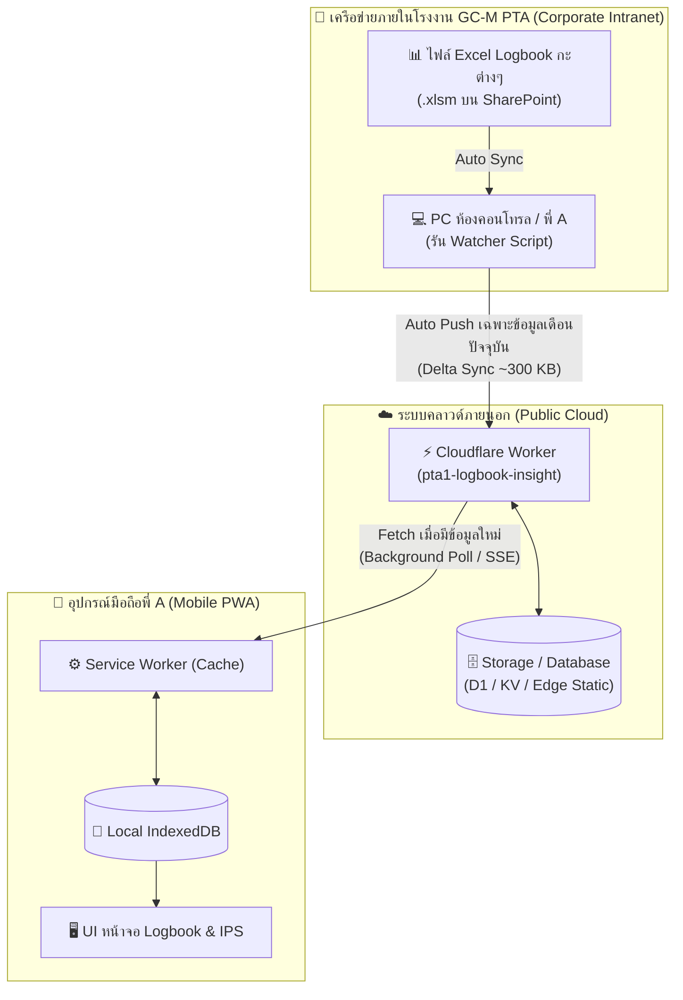

# สถาปัตยกรรม Real-Time Data Synchronization ระหว่าง PC & Mobile
> **โปรเจกต์:** PTA1 Logbook Insight & IPS Studio (GC-M PTA Unit 1)  
> **ผู้จัดทำ:** ศุภสิทธิ์ อุทัย (พี่ A · Boardman PTA1) × Antigravity Assistant  
> **วันที่บันทึก:** 23 ตุลาคม 2026  
> **สถานะ:** 📋 Proposed Blueprint (รอการตัดสินใจเพื่อดำเนินการใน Phase ถัดไป)  

---

## 1. บริบทและปัญหาที่พบ (Problem Statement)

- **สถานะปัจจุบัน:**
  - บนเครื่อง **PC สำนักงาน:** ข้อมูล Logbook ซิงค์สดจากไฟล์ Excel บน SharePoint ของ GC-M PTA (`10.Oct_2026 PTA1 FM Activity Report.xlsm` ฯลฯ) ผ่านสคริปต์ Watcher และเก็บไว้ใน IndexedDB ภายในเครื่อง PC
  - บน **Mobile PWA (Cloudflare Workers URL):** ข้อมูลยังคงเป็น Static JSON Snapshot ที่ถูกอัปโหลดขึ้นไป ณ เวลา Deploy ส่งผลให้เมื่อกะอื่นบันทึกข้อมูลใหม่ลง Excel ข้อมูลบนมือถือจะไม่เปลี่ยนตามทันที
- **ความท้าทายด้านขนาดข้อมูล:**
  - ข้อมูล 9 เดือน มีขนาดไฟล์รวม `~3.8 MB` (`4,341` รายการบันทึก)
  - หากสั่งให้มือถือดาวน์โหลดไฟล์ 3.8 MB ใหม่ทั้งก้อนทุกครั้ง จะทำให้:
    1. เปลือง Bandwidth เน็ต 4G/5G ของมือถือ
    2. หน้าเว็บหน่วง/กระตุกขณะ Parse ข้อมูลซ้ำๆ
    3. แบตเตอรี่มือถือหมดไว

---

## 2. แผนภาพการไหลของข้อมูล (Data Flow Architecture)

---

## 3. หลักการออกแบบเพื่อความเสถียรสูงสุด (Design Principles)

### ST-01: Delta Sync & Split Data Architecture (แยกไฟล์ประวัติศาสตร์ ออกจากเดือนปัจจุบัน)
เพื่อไม่ให้มือถือต้องโหลด 3.8 MB ซ้ำๆ เราจะแบ่งข้อมูลเป็น 2 ก้อน:
1. **Historical Archive Chunk (`logbook_archive_q1_q3.json`):**
   - รวบรวมข้อมูลตั้งแต่เดือน ม.ค. ถึง ก.ย. 2026 (ขนาด ~3.4 MB)
   - ข้อมูลส่วนนี้ปิดรอบไปแล้วและไม่มีการแก้ไขอีก
   - มือถือจะดาวน์โหลดเพียง **ครั้งแรกครั้งเดียว** แล้วบันทึกลง IndexedDB บนมือถือถาวร
2. **Current Active Chunk (`logbook_current.json`):**
   - มีเฉพาะข้อมูลของเดือนปัจจุบัน (เช่น ต.ค. 2026 ขนาดเพียง `~300-400 KB`)
   - เฉพาะก้อนนี้เท่านั้นที่จะถูกอัปเดตและซิงค์ใหม่
   - ใช้เวลาดาวน์โหลดไม่ถึง **0.2 - 0.4 วินาที** ทำให้เปิดดูได้รวดเร็วทันใจ

### ST-02: Metadata Ping Check (ประหยัดเน็ต 4G/5G)
- มือถือจะไม่โหลด `logbook_current.json` ตลอดเวลา แต่จะคอยตรวจสอบไฟล์ [`data/logbook_meta.json`](file:///C:/Users/26007294/A(i)CODER2025TH/PTA1-Logbook-Insight/public/data/logbook_meta.json) ซึ่งมีขนาดเพียง **`~300 bytes`**
- หากค่า `generatedAt` ใหม่กว่าเวลาที่บันทึกไว้ในเครื่อง มือถือจึงจะสั่งดาวน์โหลดข้อมูลเดือนปัจจุบันมา Merge ลง IndexedDB อัตโนมัติ

---

## 4. ตารางเปรียบเทียบ 3 แนวทางการทำ Real-Time Sync

| มิติการเปรียบเทียบ | แนวทาง A: Cloudflare D1 / KV Database ⭐ | แนวทาง B: Firebase Firestore Real-Time | แนวทาง C: Auto-Push Deploy ผ่าน Watcher |
|---|---|---|---|
| **กลไกการส่งข้อมูล** | PC ยิง HTTP POST เข้า Cloudflare Worker API เพื่ออัปเดตลง D1/KV | PC ยิงตรงเข้า Firestore Database ผ่าน Admin SDK | PC รันคำสั่ง `wrangler deploy` อัตโนมัติเมื่อตรวจพบไฟล์เปลี่ยน |
| **กลไกการรับข้อมูล** | มือถือใช้ SWR (Stale-While-Revalidate) หรือ Polling ทุก 30s | มือถือใช้ `onSnapshot` แบบ WebSocket ฟังการเปลี่ยนแปลงสด | มือถือตรวจเช็ค Metadata JSON ผ่าน Service Worker |
| **ความเร็วในการเห็นข้อมูล** | ภายใน **3 - 10 วินาที** | **วินาทีต่อวินาที (Instant < 2s)** | ภายใน **1 - 2 นาที** (ตามรอบ Deploy) |
| **ความเสถียรบนมือถือ** | **สูงสุด (10/10)** เบา ไม่เปลืองแรม/แบต | ดีมาก (9/10) อาศัยการเชื่อมต่อ Socket ตลอดเวลา | สูง (9.5/10) เป็น Static Asset ธรรมดา |
| **ความเข้ากันได้ Offline** | ใช้งานผ่าน IndexedDB ได้ 100% | มี Local Persistence ในตัว | ใช้งานผ่าน Service Worker ได้ 100% |
| **ต้นทุน / ข้อจำกัด** | ฟรี (Cloudflare D1 ฟรี 5,000,000 Reads/วัน) | ฟรี (Firestore Free Tier 50,000 Reads/วัน) | ฟรี 100% ไม่จำกัดจำนวนครั้ง |
| **ความซับซ้อนในการตั้งค่า** | ปานกลาง (เพิ่ม Worker Script API 1 เส้น) | ปานกลาง (ตั้งค่า Firebase Auth & Rules) | **ง่ายที่สุด (ปรับสคริปต์บน PC อย่างเดียว)** |

---

## 5. ข้อจำกัดและสิ่งที่ต้องคำนึงถึงหน้างานจริง (Reality Check)

1. **การเปิดเครื่อง PC ในห้องคอนโทรล:**
   - ไฟล์ Excel ตั้งต้นอยู่บน SharePoint ภายใน Firewall เครือ PTTGC
   - หากต้องการให้มือถือได้รับข้อมูลสดขณะที่พี่ A อยู่นอกโรงงาน **จะต้องมีเครื่อง PC อย่างน้อย 1 เครื่องเปิดรันสคริปต์ Watcher ทิ้งไว้** เพื่อคอยส่งข้อมูลขึ้นสู่ Cloudflare
   - *คำแนะนำ:* หากพี่ A ล็อกออฟหรือปิดเครื่อง เมื่อกลับมาเปิดเครื่องใหม่ สคริปต์จะทำการ Sync รวบยอดข้อมูลของกะที่ผ่านมาให้ทันทีโดยอัตโนมัติ
2. **ความปลอดภัยของข้อมูล (Security & Secret Key):**
   - การยิงข้อมูลจาก PC ขึ้น Cloudflare Worker จะต้องมี API Secret Token ป้องกันไม่ให้คนภายนอกยิงข้อมูลแปลกปลอมเข้ามาในระบบได้

---

## 6. ลำดับขั้นตอนการดำเนินการเมื่อพร้อมเริ่มทำ (Action Plan)

1. **Step 1:** ปรับแต่ง [`scripts/extract-logbooks.mjs`](file:///C:/Users/26007294/A(i)CODER2025TH/PTA1-Logbook-Insight/scripts/extract-logbooks.mjs) ให้สกัดแยกเป็น 2 ไฟล์: `logbook_archive.json` และ `logbook_current.json`
2. **Step 2:** ปรับแต่งสคริปต์ [`scripts/watch-logbooks.mjs`](file:///C:/Users/26007294/A(i)CODER2025TH/PTA1-Logbook-Insight/scripts/watch-logbooks.mjs) ให้มีคำสั่ง Auto-Push ขึ้น Cloudflare เมื่อตรวจพบว่าไฟล์ Excel เดือนปัจจุบันมีการแก้ไข
3. **Step 3:** ปรับแต่ง [`src/main.js`](file:///C:/Users/26007294/A(i)CODER2025TH/PTA1-Logbook-Insight/src/main.js) และ [`src/modules/storage-engine.js`](file:///C:/Users/26007294/A(i)CODER2025TH/PTA1-Logbook-Insight/src/modules/storage-engine.js) บนมือถือ ให้โหลด Historical Data เก็บไว้ถาวร และคอยดึงเฉพาะ Current Month มา Merge ข้อมูล
4. **Step 4:** ทดสอบทดลองบันทึกไฟล์ Excel บน PC แล้วดูผลลัพธ์บนจอมือถือจริง
