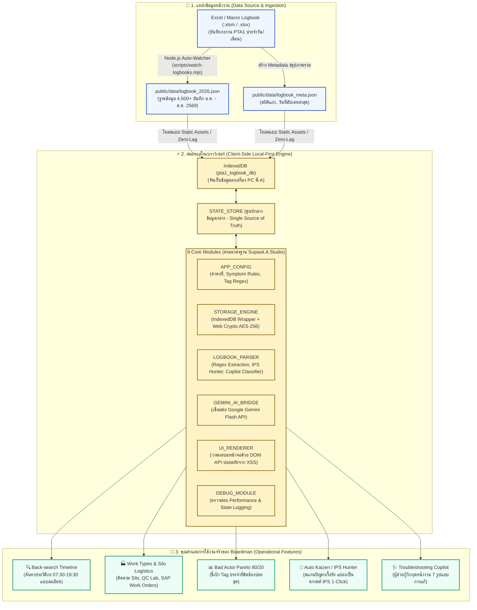

# PTA1 Logbook Insight & IPS Studio — สถาปัตยกรรมและแผนผังการทำงาน (System Architecture & Workflow)

> **เจ้าของระบบ:** คุณศุภสิทธิ์ อู่อุทัย (พี่ A) — Process/Production Engineer & Boardman PTA Unit 1, Section PE1, GC-M PTA / เครือ PTTGC  
> **มาตรฐานระบบ:** A-Class WebCraft | Code • Share • Inspire | by Supasit.A (Supasit.A Studio)  
> **วันที่มีผลบังคับใช้ / บันทึกเอกสาร:** 24 ตุลาคม 2569 (2026-10-24)

---

## 🗺️ 1. แผนผังสถาปัตยกรรมการทำงานรวม (System Architecture Flowchart)

---

## ⚙️ 2. เจาะลึกกระบวนการทำงาน 3 ชั้น (The 3-Tier Execution Layer)

### ชั้นที่ 1: Data Ingestion & Extraction Layer (จากสมุดบันทึกสู่ข้อมูลดิจิทัล)
1. **ไฟล์ต้นทาง (Source Files):**
   - ไฟล์ Excel Macro-enabled (`.xlsm`) หรือ Spreadsheet (`.xlsx`) บันทึกการส่งกะของโรงงาน PTA1 ที่เก็บใน OneDrive/SharePoint หรือไดรฟ์เครื่องคอมพิวเตอร์
2. **กระบวนการแปลงข้อมูลอัตโนมัติ (Automated Extraction):**
   - คำสั่ง `npm run extract` หรือ `scripts/watch-logbooks.mjs` ทำหน้าที่สแกนไฟล์ Excel แต่ละเดือน (ม.ค. - ต.ค. 2569)
   - สกัดหัวข้อสำคัญ: วันที่, กะงาน (เช้า/ดึก), คอลัมน์เวลา, ชื่องาน (Work Category), และข้อความบันทึกรายละเอียด (Event Description)
   - ผลลัพธ์ถูกรวมเป็นไฟล์ JSON ขนาดกะทัดรัดที่ `public/data/logbook_2026.json` (ข้อมูลมากกว่า 4,560 รายการ)

---

### ชั้นที่ 2: Client-Side Local-First Engine (เครื่องยนต์ในเบราว์เซอร์)
1. **Local-First ด้วย IndexedDB (`pta1_logbook_db`):**
   - ข้อมูล 4,500+ บันทึกจะถูกดึงเข้าเก็บในเบราว์เซอร์ของเครื่อง PC ทันทีที่เปิดหน้าเว็บ
   - ทำให้การค้นหา, กรองข้อมูล, หรือคำนวณ Pareto ทำได้เร็วภายในเวลาไม่ถึง **10-50 Milliseconds**
   - ทำงานแบบ Offline ได้สมบูรณ์ แม้เครือข่ายโรงงานมีปัญหา
2. **ความปลอดภัยระดับองค์กร (Security & Privacy):**
   - **XSS Prevention:** ทุกข้อความบันทึกจะถูก Render ผ่าน DOM API (`document.createElement`, `textContent`) ห้ามใช้ `innerHTML` กับข้อความที่สกัดมาจาก logbook โดยเด็ดขาด
   - **Web Crypto AES-GCM 256-bit:** API Key ของ Google Gemini จะถูกเข้ารหัสด้วยกุญแจความปลอดภัยระดับสูงสุดใน Local Storage เครื่องพี่ A โดยตรง ไม่มีการส่งออกไปภายนอก
3. **9 Core Modules Architecture (ตามมาตรฐาน Supasit.A):**
   - `APP_CONFIG`: จัดเก็บค่าคงที่ เช่น หมวดหมู่อาการผิดปกติ (Symptom Categories), Tag Regex Patterns และเกณฑ์ความถี่ Bad Actor
   - `STATE_STORE`: Single Source of Truth จัดเก็บสถานะกะที่เลือก, หมวดหมู่งาน, คำค้นหา, และสถานะของ Copilot
   - `STORAGE_ENGINE`: จัดการการอ่าน/เขียน IndexedDB และถอดรหัส Key
   - `LOGBOOK_PARSER`: ตัววิเคราะห์อัจฉริยะ ทำหน้าที่ Regex Tag Extraction, วิเคราะห์ 7 มาตรการแก้ไข และคำนวณเคส IPS Hunter
   - `GEMINI_AI_BRIDGE`: เชื่อมต่อ Google Gemini Flash API สำหรับร่างรายงาน Kaizen 7 ขั้นตอน และ Five-Why Analysis
   - `UI_RENDERER`: วาดส่วนประกอบหน้าจอ UI ทั้งหมด (Timeline, Cards, Badges, Charts)
   - `DEBUG_MODULE`: วัดประสิทธิภาพและช่วยตรวจสอบข้อผิดพลาดระหว่างรัน

---

### ชั้นที่ 3: Operational Features & Value Delivery (5 เครื่องมือสำหรับ Boardman)

| เครื่องมือ | วัตถุประสงค์การใช้งานหน้างาน | สิ่งที่ระบบส่งมอบให้ผู้ใช้งาน |
| :--- | :--- | :--- |
| **🔍 1. Back-search Timeline** | ค้นหาย้อนหลังเพื่อดูประวัติการเดินเครื่องในแต่ละกะ | ไทม์ไลน์ต่อเนื่อง 07:30 - 19:30 น., เลือกดูเฉพาะกะที่พี่ A เข้าเวรได้ในคลิกเดียว |
| **🏭 2. Work Types & Logistics** | แยกหมวดหมู่งานเฉพาะทางของโรงงาน PTA1 | แท็บแยกสำหรับ Silo Management, การล้างระบบ (Washing), ผลวิเคราะห์ QC Lab และใบสั่งซ่อม SAP Memos |
| **📊 3. Bad Actor Pareto 80/20** | วิเคราะห์หาอุปกรณ์ที่เป็นปัญหาเรื้อรังตามหลักวิศวกรรม | กราฟ Pareto 80/20 ชี้เป้า Tag ที่เกิดปัญหาซ้ำซากสูงสุด ช่วยวางแผน Preventive Maintenance |
| **🎯 4. Auto IPS / Kaizen Hunter** | สแกนหาปัญหาในอดีตมาแปลงเป็นผลงานปรับปรุง (IPS) | สรุปเปรียบเทียบ "ก่อนปรับปรุง / หลังปรับปรุง" พร้อมคำนวณ Benefit มูลค่าผลตอบแทน เป็นดราฟต์พร้อมส่งระบบ HCL Notes |
| **🩺 5. Troubleshooting Copilot** | ผู้ช่วยกู้วิกฤตหน้างานเมื่อเกิดเหตุการณ์ผิดปกติในกะ | เมนูด่วนเลือกอาการ (Hunting, Leak, Tripped, Clog ฯลฯ) แล้วระบบจะแนะนำ 7 แนวทางแก้ไขที่เคยทำสำเร็จในอดีต |

---

## 🛡️ 3. ข้อกำหนดและมาตรฐานทางวิศวกรรม (Engineering Standards)

- **ความคมชัดและโทนสี (Supasit.A Studio):**
  - สีหลักสำหรับสิ่งที่กดได้: Ink Blue (`#1D4ED8`)
  - สีข้อมูลอ้างอิงและคำเตือน: Amber (`#8A6410`)
  - พื้นผิว (Surface): ขาวตัดกับพื้นหลัง `#F7F9FC` อย่างชัดเจน
  - Contrast Ratio ต้องผ่านเกณฑ์ ≥ 4.5:1 ทั้งโหมดสว่างและโหมดมืด
- **Red-Green Code Delivery & Automated Verification:**
  - ทุกฟังก์ชันสำคัญของ `LogbookParser` ผ่านการทดสอบ Unit Tests ด้วย **Vitest** (ปัจจุบัน 26/26 Tests เขียว 100%)
  - มีคำสั่ง `npm run check` ตรวจสอบทั้ง Unit Tests และ Production Build ก่อนขึ้นใช้งานจริงเสมอ

---

## 🚀 4. แนวทางการขยายผลในอนาคต (Scalability & Multi-PC Roadmap)

เอกสารนี้ทำงานประสานร่วมกับ:
- [`UNIVERSAL_LOGBOOK_ROADMAP.md`](./UNIVERSAL_LOGBOOK_ROADMAP.md): แผนที่นำทางสำหรับการขยายระบบไปยังเครื่อง PC อื่นๆ ในโรงงาน PTA หรือหน่วยผลิตอื่นๆ
- [`01_IPS_Kaizen_Candidates_Oct2026.md`](./01_IPS_Kaizen_Candidates_Oct2026.md): บันทึกรายการเครื่องจักรเป้าหมายสำหรับการทำ Individual Kaizen
