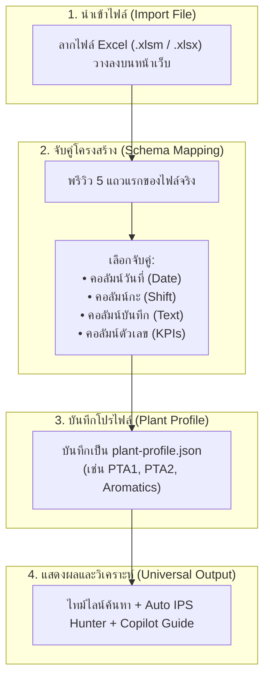

# Universal Plant Logbook Expansion Blueprint
> เอกสารสถาปัตยกรรมและคู่มือการขยายระบบสู่เครื่อง PC และหน่วยผลิตอื่น (PTA2 / Aromatics / GC Plants)  
> บันทึกเมื่อ: 24 ต.ค. 2026 | ผู้รับผิดชอบ: พี่ A (Supasit Aoothai) & AI Assistant

---

## 🎯 วัตถุประสงค์ (Objective)
บันทึกแนวทางและพิมพ์เขียวทางวิศวกรรมซอฟต์แวร์สำหรับการนำระบบ **PTA1 Logbook Insight & IPS Studio** ไปใช้งานต่อบนเครื่อง PC เครื่องอื่นๆ ที่มีไฟล์ Logbook ในรูปแบบคล้ายคลึงกัน แต่มีโครงสร้างคอลัมน์, ชื่อ Sheet, รูปแบบ Tag อุปกรณ์ หรือดัชนีชี้วัด (KPIs) ที่แตกต่างกัน โดยไม่จำเป็นต้องเขียนโค้ดใหม่ตั้งแต่ต้น

---

## 🧭 สถานะปัจจุบัน & ลำดับความสำคัญ (Current Status)
* **ระยะปัจจุบัน (Phase 0 - Stabilization):** พี่ A กำลังทดสอบเดินระบบจริงบนเครื่อง PC นี้ให้เสถียรและคุ้นเคยกับฟีเจอร์ทั้งหมดก่อน (Live SharePoint Watcher, Troubleshooting Copilot, Auto IPS Hunter)
* **ระยะขยายผล (Phase 1 - Expansion):** เมื่อระบบบนเครื่องหลักนิ่งแล้ว จึงเริ่มขยายไประบบและเครื่อง PC อื่นตามพิมพ์เขียวนี้

---

## 🧩 1. ความแตกต่างที่มักพบในไฟล์ Logbook แต่ละหน่วยผลิต

| จุดที่แตกต่าง | ตัวอย่างใน PTA Unit 1 (ปัจจุบัน) | ตัวอย่างในโรงงานอื่น / เครื่องอื่น | วิธีการปรับตัวของระบบ (Universal Solution) |
|---|---|---|---|
| **ตำแหน่งคอลัมน์ (Column Layout)** | Col A = Date, Col C = Shift, Col G = Log Text | Col B = Date, Col D = Shift, Col H = Note | **Interactive Schema Mapper:** ให้เลือกจับคู่คอลัมน์ผ่าน Dropdown บนหน้าเว็บ |
| **ชื่อ Sheet ในไฟล์ Excel** | `FM activity report`, `BM Activity` | `Daily Log`, `Shift Report`, `Sheet1` | **Dynamic Sheet Selector:** สแกนรายชื่อ Sheet ทั้งหมดมาให้คลิกเลือก |
| **ดัชนีชี้วัดหลัก (KPIs)** | `4-CBA (ppm)`, `DP-2500`, `Prod` | `Acid Purity`, `Steam Ratio`, `Yield`, `BHT` | **Dynamic KPI Engine:** กำหนดชื่อตัววัดและเกณฑ์ Target Min/Max ได้อิสระ |
| **รูปแบบ Tag อุปกรณ์** | `PM-xxx`, `LCV-xxxx`, `PTK-xxx`, `Silo 800` | `P-101`, `FV-200`, `V-300`, `TK-500` | **Configurable Tag Regex:** ตั้งค่า Pattern รหัสเครื่องจักรได้เองในหน้า Settings |
| **สภาพแวดล้อมเครื่อง PC** | มี Node.js, OneDrive shortcut, Task Scheduler | เครื่องไม่มี Node.js / ไม่สามารถรัน script ได้ | **Zero-Install Client-Side:** รันผ่าน Web Browser 100% สกัดไฟล์ด้วย `DecompressionStream` |

---

## 🏗️ 2. สถาปัตยกรรม 4 เสาหลักสำหรับระบบอเนกประสงค์ (4 Universal Pillars)



### เสาหลักที่ 1: Interactive Schema Mapper (ระบบจับคู่คอลัมน์บนหน้าเว็บ)
* เมื่อเปิดไฟล์ของโรงงานใหม่ หน้าเว็บจะแสดงตัวอย่าง 5 บรรทัดแรกของตาราง
* มีตัวเลือกให้ผู้ใช้ระบุ:
  1. แถวเริ่มต้นของข้อมูล (Data Start Row, เช่น เริ่มที่แถว 5)
  2. คอลัมน์วันที่ (Date Column)
  3. คอลัมน์ช่วงกะ (Shift Column: เช้า/ดึก หรือ Day/Night)
  4. คอลัมน์ข้อความบันทึก (Event Description Column)
  5. คอลัมน์ตัวเลข KPI ที่สนใจ (เลือกได้ 1–3 ตัววัด พร้อมตั้งชื่อเล่น)

### เสาหลักที่ 2: ระบบจัดการโปรไฟล์โรงงาน (Plant Profile Configuration)
* แยกการตั้งค่าโรงงานออกจากโค้ด โดยเก็บเป็นไฟล์ JSON โครงสร้างมาตรฐาน:
```json
{
  "plantName": "PTA Unit 2",
  "section": "PE2",
  "defaultBm": "ชื่อ Boardman",
  "tagPattern": "([A-Z]{2,4})-?(\\d{3,4}[A-Z]?)",
  "kpiTarget": {
    "primaryName": "4-CBA",
    "targetMax": 15.0,
    "unit": "ppm"
  },
  "columns": {
    "dateCol": 0,
    "shiftCol": 2,
    "logTextCol": 6,
    "kpiCol": 4
  }
}
```
* **ความสะดวก:** สามารถกด `Export Profile` จากเครื่องหนึ่ง ไปกด `Import Profile` บนอีกเครื่องหนึ่งได้ทันที

### เสาหลักที่ 3: สถาปัตยกรรมแบบ Zero-Install (ทำงานผ่าน Browser 100%)
* สำหรับเครื่อง PC อื่นๆ ในโรงงานที่ไม่สะดวกติดตั้ง Node.js หรือ Git:
  * สามารถเปิด Web App ผ่าน Production URL (เช่น Cloudflare Pages/Workers)
  * อาศัยเทคโนโลยี `DecompressionStream` สกัดไฟล์ Excel ขนาดใหญ่ 400+ MB ในหน่วยความจำของเบราว์เซอร์
  * ข้อมูลทั้งหมดถูกเก็บใน **IndexedDB ภายในเครื่องนั้นๆ** แบบ Local-First ปลอดภัยตามมาตรฐานความปลอดภัยข้อมูลโรงงาน 100% ไม่ส่งข้อมูลออกนอกเครือข่าย

### เสาหลักที่ 4: Dynamic Copilot & Auto Hunter Engine
* ระบบวิเคราะห์อาการผิดปกติ (Hunting, Alarm, Trip, Clogged, Leak) และระบบคำนวณเงินผลตอบแทน IPS ข้อ 1.1 จะปรับตัวตาม Tag Pattern และข้อมูลที่จับคู่ไว้โดยอัตโนมัติ

---

## 📋 3. ขั้นตอนการลงมือทำเมื่อพี่ A พร้อมขยายผล (Execution Steps)

เมื่อพี่ A ใช้งานบนเครื่องปัจจุบันจนมั่นใจและพร้อมขยายไประบบอื่น สามารถแจ้ง AI ให้ดำเนินการตามลำดับขั้นนี้ได้ทันทีค่ะ:

1. **สกัด Schema Config เข้า `storage-engine.js` (IndexedDB Settings):**
   * ปรับให้ `AppConfig` สามารถอ่านค่า Configuration จาก IndexedDB แทน Hardcoded constants
2. **สร้าง UI Modal "ตั้งค่าโครงสร้างตาราง (Schema Mapper)":**
   * เพิ่มปุ่ม `⚙️ ตั้งค่าตาราง Excel` ในแท็บเครื่องมือ
   * แสดงตารางพรีวิวและช่อง Dropdown เลือกคอลัมน์
3. **ปรับฟังก์ชัน Stream Parser ใน `logbook-parser.js`:**
   * ให้ใช้ Index คอลัมน์แบบ Dynamic ตาม Profile แทนค่าคงที่เดิม
4. **ทำระบบ Export / Import Profile:**
   * ทำปุ่ม Save Profile เป็น `.json` สำหรับส่งต่อให้เพื่อนร่วมงานหรือเปิดในเครื่องใหม่

---

## 📌 Checklist ตรวจสอบความพร้อมก่อนขยายไประบบอื่น
- [ ] ใช้งาน SharePoint Live Sync และ Watcher บนเครื่องปัจจุบันอย่างต่อเนื่อง 1–2 สัปดาห์
- [ ] ตรวจสอบว่าระบบค้นหาย้อนหลังและตัวกรองกะของพี่ A แสดงผลถูกต้องแม่นยำ
- [ ] ทดลองใช้ปุ่ม `⚡ โหลดใส่ฟอร์ม IPS` และคัดลอกร่าง IPS ไปส่งในระบบ HCL Notes จริง
- [ ] นำไฟล์ Excel ตัวอย่างของเครื่องเป้าหมายเครื่องถัดไป มาเปิดดูตำแหน่งคอลัมน์เพื่อเตรียมการจับคู่ (Schema Mapping)
